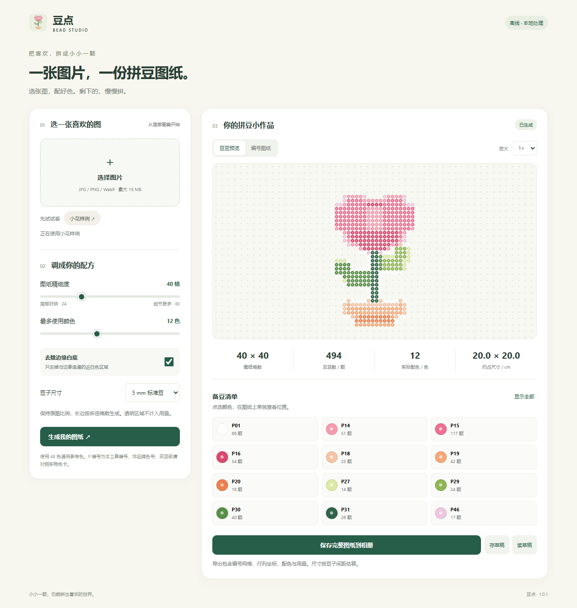
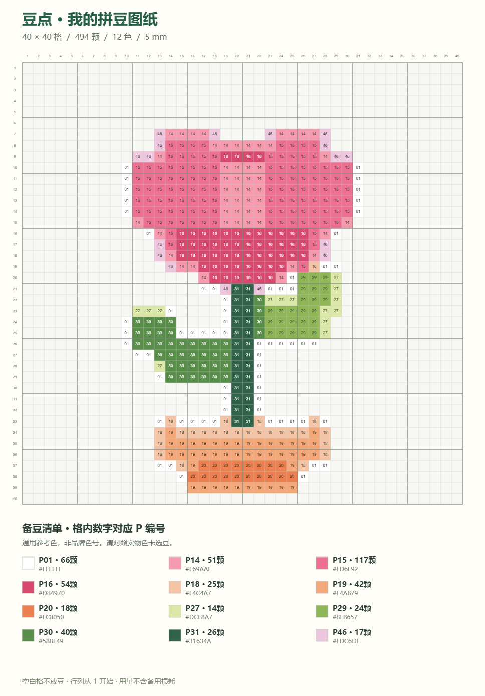

# 小红书小工具工作台

把想法做成离线 H5 小工具，生成小红书创服平台可上传的代码 ZIP。附带「图片转拼豆图纸」模板，可直接修改，也可以作为其他工具的起点。

**技能 v1.0.1 · 拼豆模板 v1.0.1**

[中文上手教程](docs/quickstart.md) · [常见问题](docs/quickstart.md#常见问题) · [版本记录](CHANGELOG.md)

**公开预览版。** [下载 v1.0.1](https://github.com/icoresss/xhs-minitool-studio/releases/tag/v1.0.1)。已完成本地检查，创服平台与真机验收待完成。

| 下载文件 | 用途 |
| --- | --- |
| `xhs-minitool-studio-1.0.1.zip` | 技能安装包，解压后将 xhs-minitool-studio 文件夹放入技能目录 |
| `bead-helper-template-1.0.1.zip` | 通用小花示例的运行代码包，供按当前官方口令复核、部署测试 |
| `SHA256SUMS.txt` | 两个 ZIP 的 SHA256 校验值 |

GitHub 自动提供的 Source code ZIP 也是仓库源码，不是小红书运行代码包。

这不是小红书官方技能。平台约束始终以当前上传页改写口令、对应官方 skill 和在线文档为准。本仓库不重新分发官方 skill。

## 实际效果

下面是通用小花模板的本地浏览器截图，展示 40 × 40 格、最多 12 色的示例。图纸和用量表由实际程序生成。



| 输入图片 | 实际导出的编号图纸 |
| --- | --- |
|  |  |

示例结果：**494 颗豆、12 种参考色**。参数变化后，图纸和统计也会变化。手机布局与编号视图见[完整教程](docs/quickstart.md#使用拼豆小工具)。截图不代表创服平台或真机验收通过。

## 安装 skill

将整个仓库作为一个技能目录安装，不要只复制 SKILL.md：

Codex 个人安装按当前官方文档采用 `~/.agents/skills/`。已有安装能正常发现时，不必重复安装。

Windows PowerShell：

```powershell
git clone https://github.com/icoresss/xhs-minitool-studio.git "$env:USERPROFILE/.agents/skills/xhs-minitool-studio"
```

macOS / Linux：

```sh
git clone https://github.com/icoresss/xhs-minitool-studio.git ~/.agents/skills/xhs-minitool-studio
```

Claude Code：在目标项目目录运行。

```sh
git clone https://github.com/icoresss/xhs-minitool-studio.git .claude/skills/xhs-minitool-studio
```

公开仓库可直接克隆，也可下载 Release 中的技能安装包。已存在目录时不要覆盖，先检查现有技能。

安装与发现方式见 [Codex 官方说明](https://developers.openai.com/codex/skills) 和 [Claude Code 官方说明](https://code.claude.com/docs/en/skills)。本项目没有完成所有 AI 宿主客户端的端到端实测。

## 使用

```text
用 $xhs-minitool-studio 做一个拼豆配色小助手。
保留图片转图纸、配色用量和相册保存，项目写到我指定的新目录。
小工具版本使用 1.0.1，输出运行代码 ZIP 和校验摘要。
我会提供上传页的最新完整改写口令，请按它完成最终校验。
```

也可以提供已有项目路径，只做兼容修复和打包。准备好上传页的最新完整改写口令，技能会按它执行官方规范核对。

上面的 `$` 调用适用于 Codex CLI/IDE；其他桌面界面使用自身的技能选择器。Claude Code 可使用 `/xhs-minitool-studio` 再描述需求。

## 不通过 AI 也能试用模板

脚本需要 Python 3.8+，仅用标准库；克隆仓库需要 Git。无外部 API key 和前端构建依赖。AI 编程工具自身的账户和费用由相应产品决定。以下命令在本仓库根目录运行，输出目录与输出文件必须尚不存在：

```sh
python scripts/new_tool.py --output ../my-bead-tool --title "拼豆配色小助手"
python scripts/pack_tool.py --source ../my-bead-tool --output ../bead-helper-1.0.1.zip --report ../bead-helper-1.0.1-preflight.json
python scripts/test_pack.py
```

普通浏览器可打开生成目录内的 index.html 试用界面；相册保存等需要小红书容器。浏览器内的保存按钮在无平台接口时显示完整图纸预览。

如系统使用 `python3` 或 `py -3`，请将上述 `python` 替换成可用命令。最终上传前仍需按官方 skill 校验。

## 拼豆模板

- 48 色通用参考色，4–24 色上限，保持图片比例。
- 长边 24–80 格，边缘白底去除、透明像素留空。
- 拼豆预览、编号图纸、颜色定位、用量与尺寸估算。
- 图纸保存到相册，单份本机草稿，平台缓存升级迁移。
- 无联网依赖、无需 API key、无构建依赖，使用经典 JavaScript 和 Canvas 2D。

P 编号属于模板自身，并非任何品牌官方色号。默认素材是通用小花；用户角色和其他项目资料不在本仓库中。

## 两种包、两个版本

| 项目 | 当前版本 | 用途 |
| --- | --- | --- |
| xhs-minitool-studio 技能 | 1.0.1 | 给 AI 的工作流程、模板和脚本；本次补教程与截图 |
| 拼豆小工具 / 随包模板 | 1.0.1 | 小红书中运行的 H5 产品；原有 v1.0.1 代码包不变 |

两个版本独立维护，不要求永远相同。小红书版本栏填写本次**小工具代码包版本**。

**技能安装包不能上传到小红书的代码上传栏。** 从运行目录打出的 ZIP 才是运行代码包，解压后根目录直接有 index.html。

## 验证与发布

已通过技能格式校验、5 项打包行为测试、示例初始化及打包、示例 ZIP 官方包体审计。本地浏览器有模板交互回归结果。

打包脚本检查结构、静态资源、常见禁用模式及包体，不能解析全部 JavaScript/CSS 语义，也不能代替官方审计或真机验收。交付后需用同一 ZIP 完成创服平台模拟器、Android 真机与 iOS 真机扫码验证。Chrome 61 与真机性能尚未实测。

上传流程和「无可提审的开发包」排查见[中文教程](docs/quickstart.md#上传到小红书)。问题反馈与贡献方法见[贡献说明](CONTRIBUTING.md)。公开 GitHub Release 不表示小工具已通过小红书审核。

源码与通用模板使用 MIT 许可证。第三方官方技能及文档不属于此许可证授权范围。
