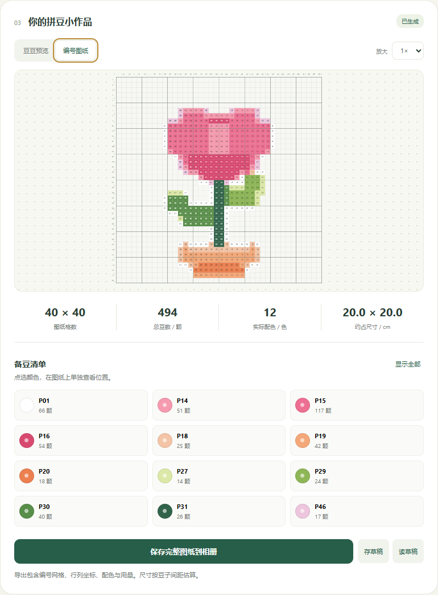
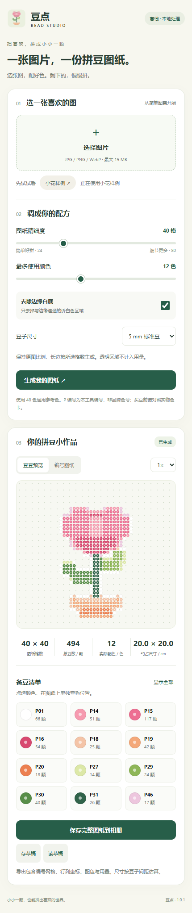

# 从安装 skill 到上传小红书

适用版本：**技能 v1.0.1，拼豆模板 v1.0.1**。更新日期：2026-10-22。

本教程使用通用小花样例。图标、人物、文案和界面可在自己的项目中替换。截图来自实际本地程序，不是小红书平台截图。

## 先准备什么

需要能读取本地技能的 AI 编程工具、Git，以及 Python 3.8+。已有模板只想直接试用，也可以不经过 AI，使用下文脚本。

若要在小红书内预览、提审和发布，需要账号自身能进入创服平台的小工具上传入口。安装本技能不会自动获得平台入口或审核资格。

检查命令：

```sh
git --version
python --version
```

Windows 可尝试 `py -3 --version`，macOS/Linux 可尝试 `python3 --version`。后面的 Python 命令使用同一个可用程序。

## 安装并确认可用

按 [README 安装说明](../README.md#安装-skill) 把整个仓库装进对应工具的技能目录。私有仓库需要已有访问权限；不要把密码或访问令牌贴进对话。

Codex 当前官方文档将个人技能目录列为 `~/.agents/skills/`，项目技能目录为 `.agents/skills/`。之前由安装器装在其他路径并已能正常使用的技能，不必重复安装。Claude Code 的项目技能在 `.claude/skills/`，个人技能在 `~/.claude/skills/`。

安装后应是下面这样，别把整个仓库再多套一层：

```text
xhs-minitool-studio/
├── SKILL.md
├── agents/
├── scripts/
├── references/
├── assets/bead-helper/
└── docs/
```

在 Codex CLI/IDE 中输入 `$` 或用 `/skills` 查找；桌面界面使用自身的技能选择入口。Claude Code 可输入 `/xhs-minitool-studio`。未被发现时检查路径、文件名和重名技能，再尝试重启工具。

安装与调用依据：[OpenAI 官方技能文档](https://developers.openai.com/codex/skills)、[Claude Code 官方技能文档](https://code.claude.com/docs/en/skills)。本项目没有声称完成全部宿主客户端的端到端实测。

## 让 AI 创建或修改工具

第一次使用，指定一个全新的项目目录，可以发：

```text
用 $xhs-minitool-studio 创建拼豆配色小助手，项目写入我指定的新目录。
以随包模板为起点，保留图片导入、配色数量、去白底、编号网格、
颜色用量、图纸导出、草稿保存与恢复。
小工具版本设为 1.0.1，图标先用通用小花。
输出运行代码 ZIP、发布字段说明和校验摘要。
```

在 Claude Code 中，将开头改成 `/xhs-minitool-studio`。要修改已有项目，可以说：

```text
用 xhs-minitool-studio 检查我指定目录中的现有小工具。
本次只修复小红书兼容问题并打包，不替换品牌和功能。
保留版本 1.0.1；如果需要修改产品行为，先说明原因。
```

最终打包时，从创服平台上传页「第一步：调整为符合小红书规范的代码格式」复制**当前完整改写口令**交给 AI。口令会指向对应官方 skill。本仓库不固定这个下载地址，避免沿用过期口令。

## 使用拼豆小工具

### 1. 先试小花样例

打开程序会自动生成小花，也可以点「小花样例」恢复。桌面界面如下：


### 2. 换成自己的图片

点「选择图片」，支持 JPG、PNG、WebP。模板限制文件不超过 15 MB、图片不超过 2400 万像素。复杂照片通常需要更大网格和更多颜色；线条清楚、背景简单的图片更容易拼。

本教程的实际输入文件是 [sample-input.png](images/sample-input.png)，可以下载后自行导入：


### 3. 调整格数和颜色

- **图纸精细度**：控制长边格数，24–80 格。格数越大，需要的豆子和拼制时间通常越多。
- **最多使用颜色**：4–24 色，这是上限，简单图片可能用不到那么多。
- **去除边缘白底**：仅移除与画面边缘连通的近白区域，不是 AI 抠图。透明区域留空。
- **豆子尺寸**：5 mm / 2.6 mm，用于估算网格占用尺寸。

改好参数后点「生成我的图纸」。示例使用 40 格、最多 12 色、开启去白底，得到 **40 × 40 格、494 颗豆、12 色**。保持比例的是整个输入图片，不会自动裁掉四周留白。

### 4. 对着编号和颜色拼

切到「编号图纸」，格内数字对应清单中的 P 编号。例如格内 14 对应 P14。点清单中的颜色，只突出它的位置；再次点选或点「显示全部」取消。



手机上可用放大选项查看细节，再滚动图案区域。下面为本地浏览器 430 像素宽视口：



### 5. 保存图纸和草稿

在小红书容器内点「保存完整图纸到相册」，系统可能询问相册权限。导出图包含行列坐标、编号、参考色与用量：


普通浏览器没有小红书相册接口，按钮会打开完整图纸预览，不能据此认定相册功能已通过真机测试。

「存草稿」保存一份生成后的图纸，新稿覆盖旧稿，不保存原始照片。「读草稿」恢复后可继续看图和导出，再生成时以恢复图纸为源。重要作品请另存相册，本地缓存可能被清理。

## 直接运行脚本

无需 AI 改功能时，可从仓库根目录直接生成新项目：

```sh
python scripts/new_tool.py --output ../my-bead-tool --title "拼豆配色小助手"
```

输出目录已存在会停止，避免覆盖内容。再生成代码 ZIP：

```sh
python scripts/pack_tool.py --source ../my-bead-tool --output ../bead-helper-1.0.1.zip --report ../bead-helper-1.0.1-preflight.json
```

输出文件已存在也会停止，保留多份包时请换输出文件名。JSON 报告只代表静态预检，最终还需按官方 skill 审计及兼容性检查。

## 上传到小红书

1. **确认代码包。** 解压后根目录直接有 index.html、脚本、样式和图标，不要上传整个技能仓库 ZIP。
2. **执行当前官方口令。** 将上传页第一步的完整口令发给 AI，按对应官方 skill 校验并得到最终运行 ZIP。
3. **上传并部署。** 在第二步选择运行 ZIP，等部署成功，确认右侧显示预览。
4. **填写信息。** 名称可填「拼豆配色小助手」，简介可填「图片变图纸，配色算用量」；本次示例产品版本为 **1.0.1**。名称、简介、图标和封面限制以当前页面为准。
5. **选择权限。** 本模板需要「相册照片与视频」用于选图和保存；若另有本地存储选项，按草稿需求声明。不需要摄像头或麦克风。
6. **测试同一份包。** 在创服平台模拟器确认选图、生成、颜色定位、放大、草稿、相册允许/拒绝，再分别用 Android、iOS 真机扫码验证。
7. **提审或发布。** 确认开发包部署并通过所需测试，再按平台流程提交。上传 ZIP 不等于发布成功。

本教程不放模拟的上传成功截图；实际上传页面和审核结果取决于账号与当时的平台流程。

## 常见问题

### 不是已经 v1.0.1 了吗？

是的。原来的**拼豆小工具代码包已经是 v1.0.1**，本次补教程和截图不修改那个 ZIP。

仓库技能原为 v1.0.0，本次文档更新也升级为 v1.0.1。两者独立管理，以后可能不同。小红书版本栏填写产品代码包版本，不是把技能版本抄过去。

### 两种 ZIP 有什么区别？

| 包 | 解压后的主要内容 | 应该放哪里 |
| --- | --- | --- |
| 技能安装包 / GitHub 仓库源码包 | SKILL.md、scripts、references、assets 等 | AI 工具的技能目录 |
| 小工具运行代码包 | 根目录直接有 index.html、JS、CSS、图片 | 小红书「上传并部署代码」 |

将技能包传到小红书不能当作正确的运行代码包，两者不可混用。

### 「无可提审的开发包」怎么办？

先看第二步代码上传区域：是否选择正确 ZIP、部署成功、出现预览。只填版本、上传图标/封面或勾选权限，不会生成开发包。

如果部署成功仍报错，记录上传区域状态与版本关联信息，提供给排查人员；不要仅靠反复改版本号解决。

### P01 是什么品牌的豆子？

P01–P48 是本工具通用参考编号，不能当品牌色号采购。买豆时对照实物色卡，屏幕显示和实物可能有差异。

### 为什么无法保存到相册？

先确认在小红书容器内打开，再检查相册授权和客户端版本。普通浏览器、拒绝权限、平台方法不可用或系统保存失败，都会影响保存。

### 豆数怎么和总格数不一样？

空白与透明格不放豆。40 × 40 是 1600 个位置，实际可能只需要 494 颗豆。用量不包含操作损耗的备用豆。

### 截图证明平台兼容了吗？

没有。截图来自本地现代 Chrome，分别模拟桌面和手机视口，展示实际程序功能与输出。创服模拟器、真机以及 Chrome 61 / Android 8.1 兼容性和性能均待实测。

### 在哪里反馈问题？

在仓库 Issues 描述：AI 工具、操作系统、小工具版本、复现步骤、预期和实际结果。图纸问题最好附一张可公开的简化输入图。私有仓库只有获授权用户能访问。

## 本次验证范围

- 技能格式校验通过。
- 打包脚本 5 项行为测试通过。
- 示例初始化、静态预检、ZIP 生成和官方包体审计通过。
- 本地 CSP 环境中，输入图导入、编号视图、图纸导出和移动布局有实际运行结果。
- 创服平台模拟器、Android、iOS 扫码验收：待验证。
